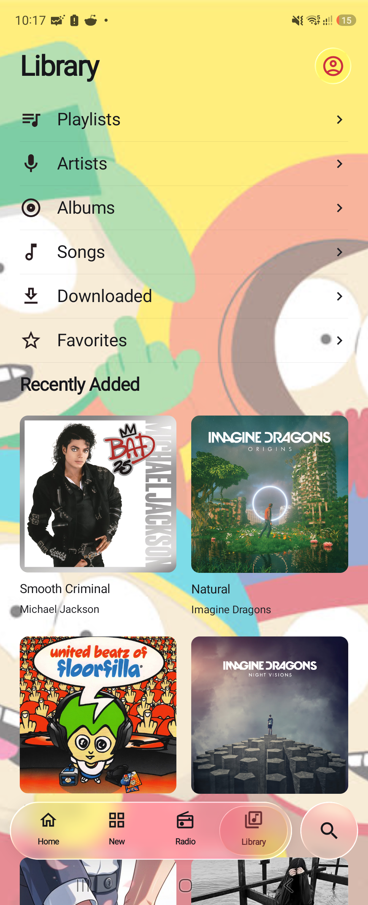
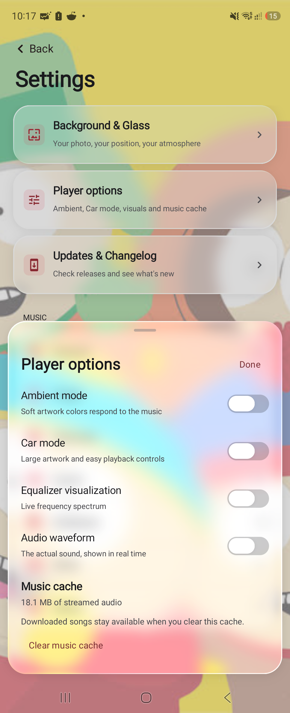
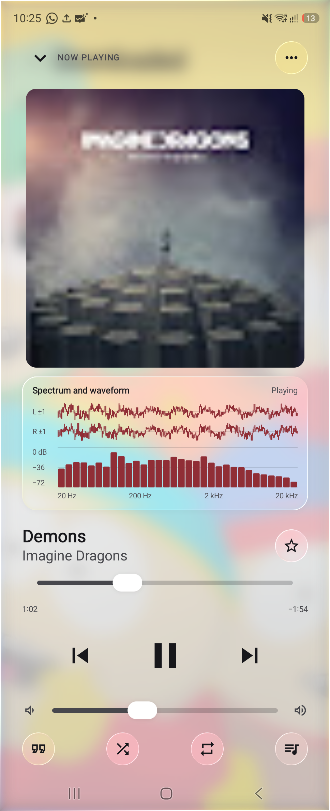
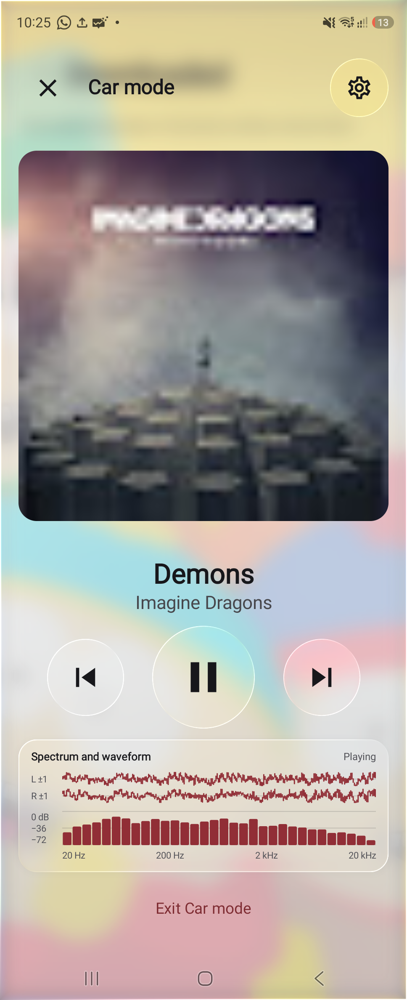

# Our Music

Our Music is an Android music player with an interface inspired by Apple Music. Large artwork, a floating navigation bar and a full screen player keep browsing and playback easy to follow.

The glass controls refract live content, including other glass surfaces beneath them. Sliders and switches respond smoothly to touch and movement. A soft background material keeps text and icons readable without outlines. You can choose a photo, move it, adjust its scale and save the result without changing the original image.

## Listening

Browse music, build playlists, save favorites and manage the playback queue. Download songs for offline listening. Synchronized lyrics highlight the current line and follow playback when timing is available. Background playback and queue controls are included. Availability depends on the music service and may vary by track.

Player options offers Ambient mode, with artwork colors that respond to the music, and Car mode, with larger playback controls. The frequency spectrum and stereo waveform use the decoded audio being played. They pause with the song and can be enabled separately or together.

You can clear streamed music from the cache in Player options. Downloaded songs, your library and background photos stay on the device. Tracks that require service verification remain subject to those restrictions; the player shows the reason when access is unavailable.

## Screenshots

These screens were captured from the app on a Samsung Galaxy Z Fold6. The background photo is customizable.

  
  
  
  

## Installation

Download the APK from the repository's Releases page and open it on an Android device. Android may ask you to allow installation from that source. The application package is `net.omusic.unreliablecode`.

## Updates

Our Music checks for published releases automatically. Updates and their changelogs are available in Settings, where you can download and install a new version without opening GitHub.

## Development

Open this project in Android Studio to build the app. [Build instructions](BUILD.md) describe the local toolchain. [Release maintenance](UPDATES.md) explains version changes and signing.

Source credits and license details are recorded in [Attribution](ATTRIBUTION.md). The application is distributed under GPL version 3, with separate licenses retained for its dependencies.
