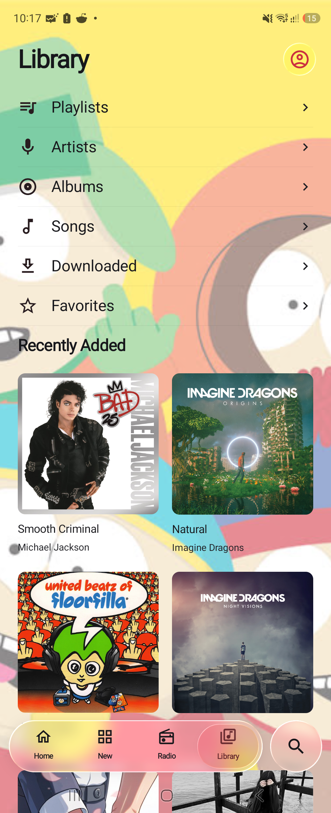
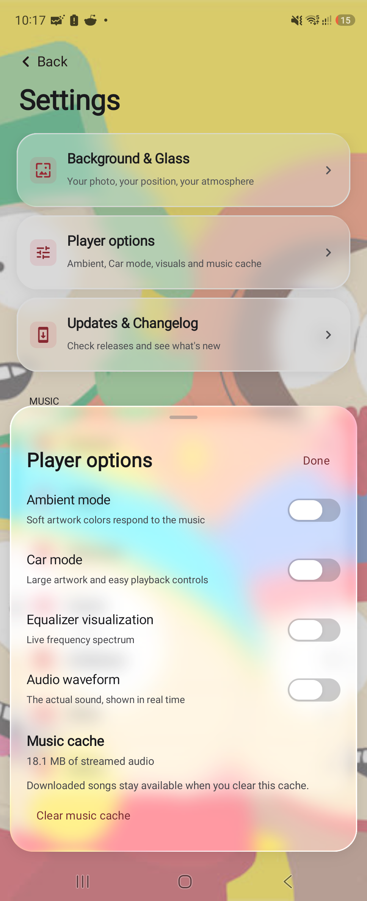
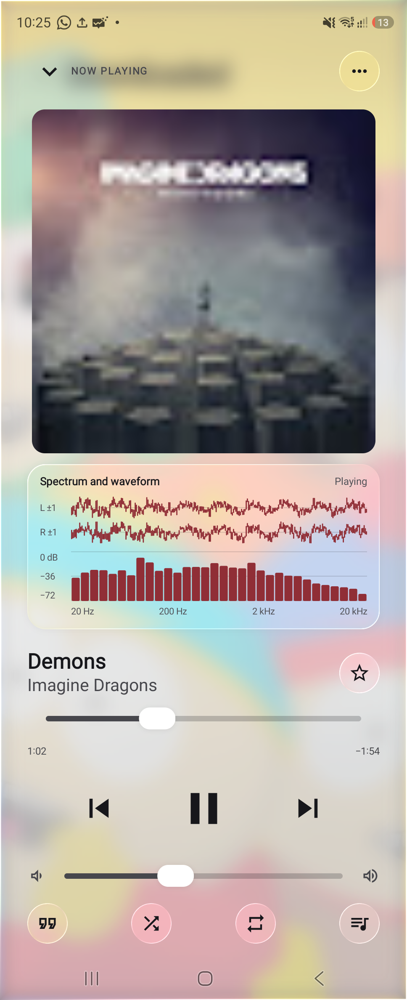
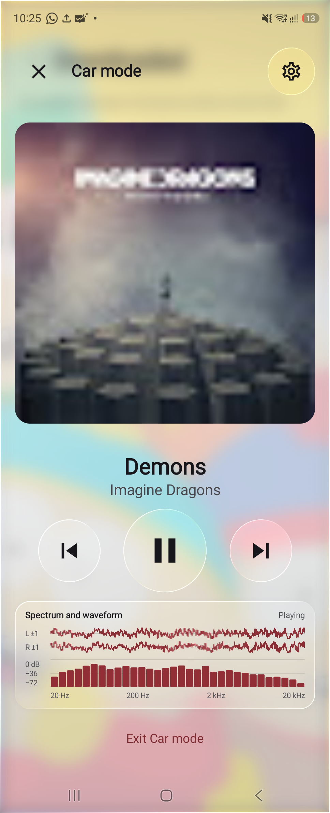
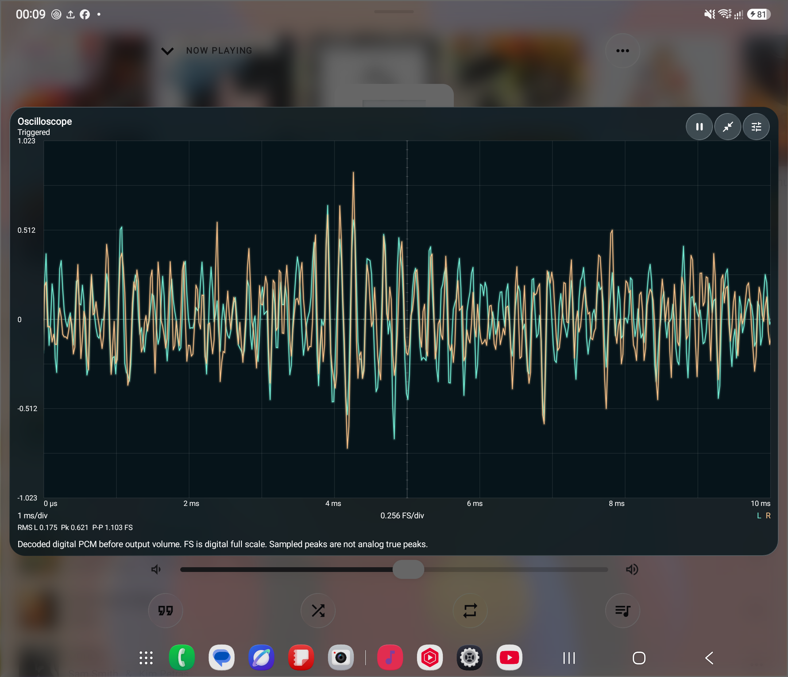
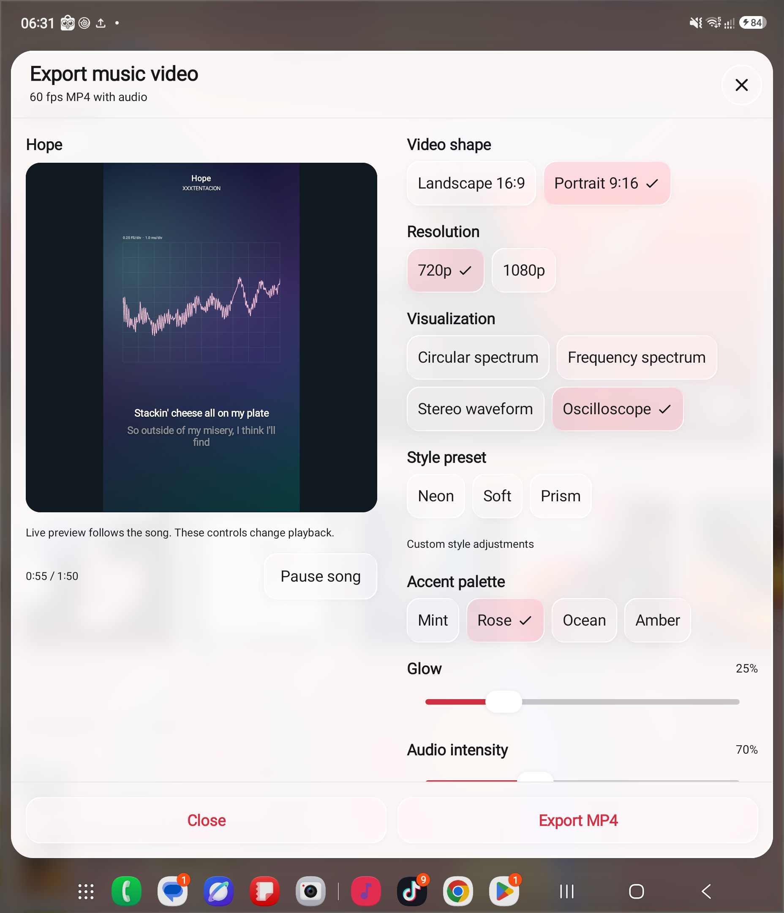

# Our Music

Our Music is an Android music player with an interface inspired by Apple Music. Large artwork, a floating navigation bar and a full screen player keep browsing and playback easy to follow.

The glass controls refract live content, including other glass surfaces beneath them. Sliders and switches respond smoothly to touch and movement. A soft background material keeps text and icons readable without outlines. You can choose a photo, move it, adjust its scale and save the result without changing the original image.

## Listening

Browse music, build playlists, save favorites and manage the playback queue. Download songs for offline listening. Synchronized lyrics highlight the current line and follow playback when timing is available. Background playback and queue controls are included. Availability depends on the music service and may vary by track.

Player options offers Ambient mode, with artwork colors that respond to the music, and Car mode, with larger playback controls. The frequency spectrum, stereo waveform and oscilloscope use decoded audio with a 60 FPS presentation target. Visuals pause with the song; the spectrum and waveform can also be shown together.

Spectrum sphere turns the decoded frequency spectrum into a luminous circular shape with moving inner filaments and particles. Its movement follows playback and audio energy. It is available during playback and when making a video.

The oscilloscope has adjustable time and amplitude scales, trigger controls, measurement cursors and Hold. Its grid shows digital full scale by default. Voltage labels require a calibration factor supplied by the user; the app does not measure the physical speaker or headphone output.

Lyrics style can be changed in Player options. Default keeps classic line highlighting, while Animated smooth adds gentle transitions and flowing movement. You can browse the lyrics and return to the current line with Follow.

You can clear streamed music from the cache in Player options. Downloaded songs, your library and background photos stay on the device. Tracks that require service verification remain subject to those restrictions; the player shows the reason when access is unavailable.

## Music videos

Open Export music video from the playback menu to turn a downloaded song into an MP4 with audio, visualization and synchronized lyrics. Choose landscape 16:9 or portrait 9:16 at 720p or 1080p. Every completed video uses a fixed 60 FPS timeline. The exporter renders every frame and checks the saved frame count and timestamps before publishing the file. Thermal throttling can increase the export time without lowering the output frame rate. The exporter uses hardware video encoding and GPU rendering when supported.

The editor offers moving Aurora, Midnight and Sunset backgrounds, album artwork and your own photo. Its live preview uses the same renderer as the saved video and follows the current song. Neon, Soft and Prism presets provide a starting point. You can adjust the accent palette, glow, response intensity, visualization size, lyrics size, background dimming and movement.

Timed lyrics use the song's saved synchronization and timing adjustment. When timing is unavailable, you can fetch lyrics or make a video with the visualization and song details.

Lyrics move smoothly into place before each cue and receive their full highlight at the saved cue time. You can also enable Music progress bar to show an animated song timeline with elapsed and remaining time. Both follow the same timing in the preview and exported video.

Exports continue in the background with progress and cancellation controls. Finished videos are saved to Movies/OurMusic and can be opened or shared from the app. A complete offline download is required so rendering can read the whole song without interruptions from the music service.

## Screenshots

These screens were captured from the app on a Samsung Galaxy Z Fold6. The background photo is customizable.

  
  
  
  

  

  

## Installation

Download the APK from the repository's Releases page and open it on an Android device. Android may ask you to allow installation from that source. The application package is `net.omusic.unreliablecode`.

## Updates

Our Music checks for published releases automatically. Updates and their changelogs are available in Settings, where you can download and install a new version without opening GitHub.

## Development

Open this project in Android Studio to build the app. [Build instructions](BUILD.md) describe the local toolchain. [Release maintenance](UPDATES.md) explains version changes and signing.

Source credits and license details are recorded in [Attribution](ATTRIBUTION.md). The application is distributed under GPL version 3, with separate licenses retained for its dependencies.
